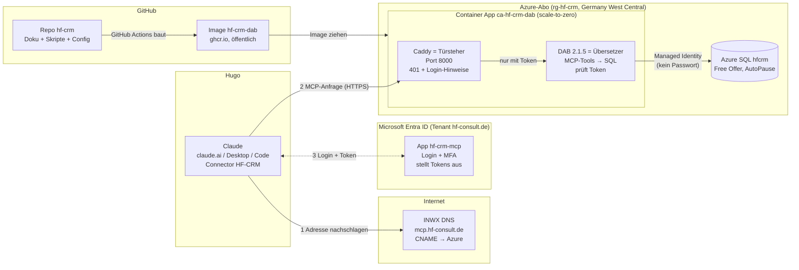
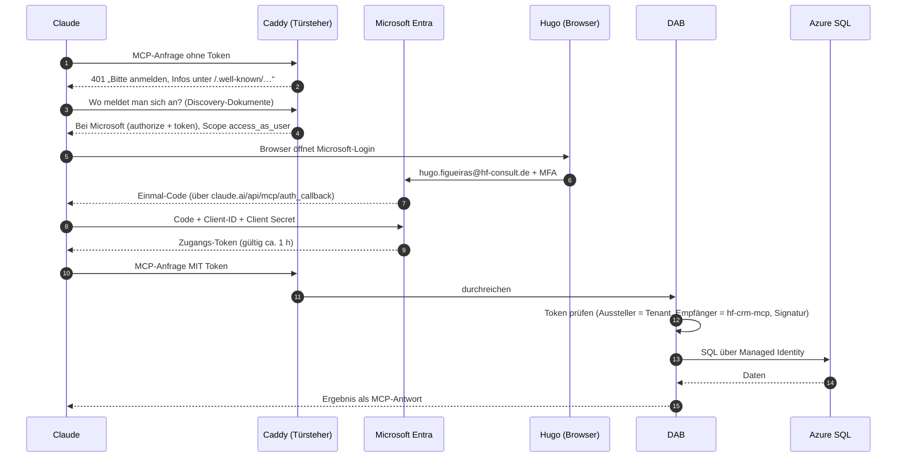
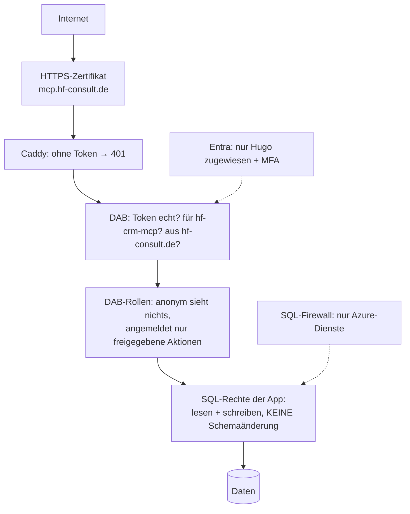
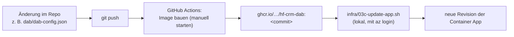

# HF-CRM – Architektur (Stand 2026-11-12)

Kurz: **Claude fragt, Microsoft prüft, wer fragt, der Türsteher lässt nur Angemeldete durch, DAB übersetzt in SQL, die Datenbank antwortet.**
Alles läuft in Hugos Azure-Abo im Tenant `hf-consult.de` (Region Germany West Central), Kosten 0 € im Normalbetrieb.

## 1. Das Gesamtbild

| Baustein | Was es ist | Wo | Kosten |
|---|---|---|---|
| **Connector `HF-CRM`** | Eintrag in claude.ai, kennt Adresse + Client-ID + Secret | claude.ai (Hugos Konto) | – |
| **DNS-Eintrag `mcp`** | „Telefonbuch“: `mcp.hf-consult.de` zeigt auf die Container App | INWX | – |
| **Entra-App `hf-crm-mcp`** | Microsofts Ausweis-Stelle für den Connector; nur Hugo ist zugelassen | Entra ID | 0 € |
| **Caddy (Türsteher)** | Lässt nur Anfragen mit gültigem Login-Token durch, erklärt Claude, wo man sich anmeldet | im Container | 0 € |
| **DAB (Data API builder)** | Macht aus der Datenbank MCP-Werkzeuge (lesen, anlegen, ändern) und prüft das Token | im Container | 0 € |
| **Container App** | Die „Maschine“, auf der Caddy + DAB laufen; schläft, wenn niemand fragt | Azure | 0 € bis ≈ 200 h/Monat |
| **Azure SQL `hfcrm`** | Die eigentliche Datenbank | Azure | 0 € (pausiert statt zu kosten) |
| **GitHub-Repo + Image** | Bauplan (Skripte, Config, Doku) und fertiges Programmpaket | GitHub | 0 € |

## 2. Was bei einer Frage in Claude passiert (Login-Ablauf)

Schritte 1–9 passieren nur beim Verbinden (und wenn das Token abläuft). Danach laufen nur noch 10–15.

## 3. Sicherheitsschichten

- **Löschen** und **Prozeduren ausführen** sind in DAB abgeschaltet.
- **Schemaänderungen** (neue Tabellen/Spalten) kann nur Hugo als Entra-Admin der Datenbank, nie die App, nie Claude.
- **Keine Passwörter** zwischen App und Datenbank (Managed Identity). Das einzige Geheimnis ist das Client Secret im claude.ai-Connector (läuft 2028-11-11 ab).

## 4. Wie Änderungen live gehen

Datenbank-Änderungen: SQL-Datei in `db/migrations/` als Vorschlag → Hugo gibt frei → `db/apply.sh` (lokal, kurz eigene IP in die Firewall).

## 5. Wo ist was (Spickzettel)

| Frage | Antwort |
|---|---|
| MCP-Adresse | `https://mcp.hf-consult.de/mcp` |
| Direktadresse (ohne eigene Domain) | `https://ca-hf-crm-dab.purpleflower-b72b09c0.germanywestcentral.azurecontainerapps.io` |
| Entra-App / Client-ID | `hf-crm-mcp` / `c3f40bf1-158a-4fff-8c08-de80976c7875` |
| Datenbank | `sql-hf-crm-106af6.database.windows.net`, DB `hfcrm` |
| Ressourcengruppe / Abo | `rg-hf-crm` / `b349b1a4-88aa-4b1f-82bf-8b24bbe47daa` |
| DNS | INWX (Konto auf Hugos privater E-Mail) |
| Alle Namen zentral | `infra/00-vars.sh` |
| Was ist wann passiert | `docs/LOG.md` · Stand + nächster Schritt: `docs/STATUS.md` |

## 6. Was noch fehlt

1. **Schema** (Phase 3): Tabellen für Mandanten, Termine, Verträge … → dann echte Entities statt Platzhalter `Verbindungstest`.
2. **Budget-Alarm** (O8) vor der Umstellung auf Pay-As-You-Go (11.12.2026).
3. Copilot Studio (nur lesen), Routine/Telegram, Dashboard (Phasen 6–8).
